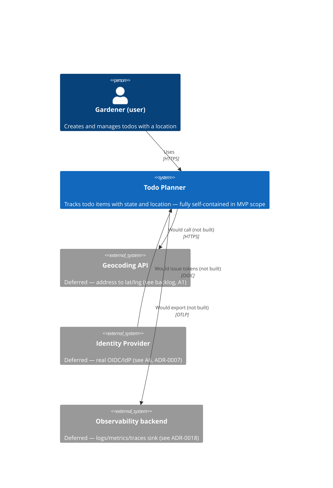
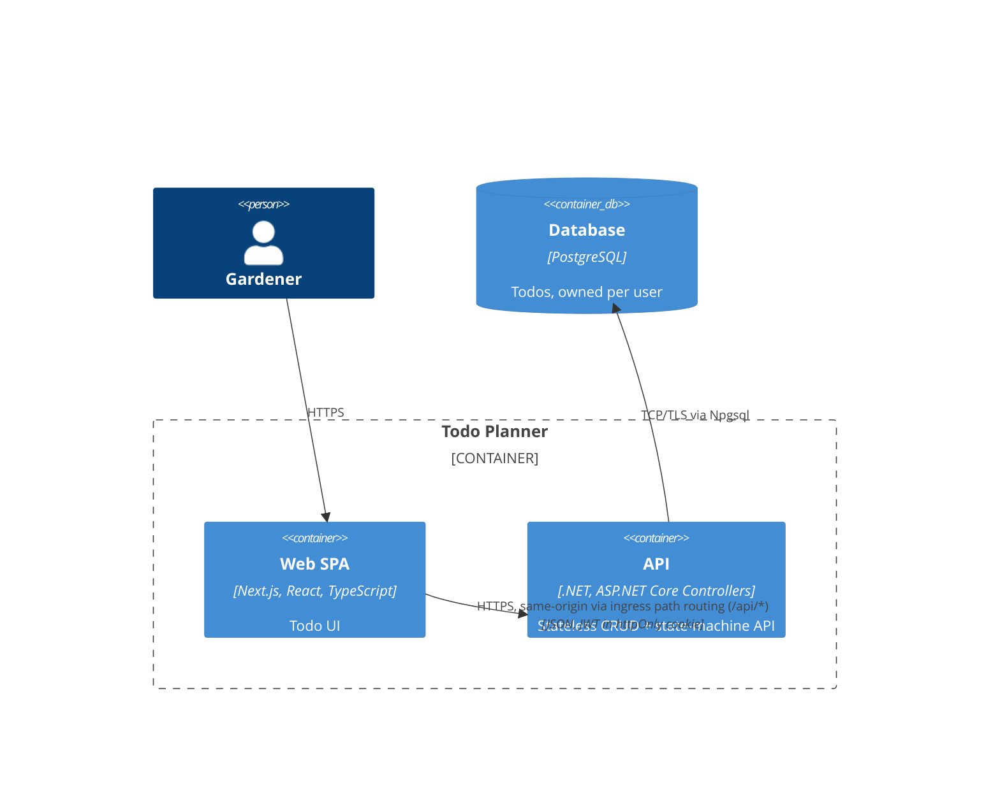

# Architecture

## Drivers
- **Functional:** CRUD on todos; state transitions (todo/scheduled/done); owner-scoped access (A4).
- **Quality (from `requirements.md`), high-priority:** Q1 (owner isolation), Q2 (correct state transitions), Q7 (stateless API / scalability).
- **Quality, secondary:** Q3 (pagination performance), Q4 (zero-downtime deploy), Q6 (concurrency safety).
- **Hard constraints (from the brief — not my choice):** frontend is React, React Native, or Flutter; backend is .NET, Java, Node.js, Python, or Rails; API style is unspecified; cloud is AWS or Azure; Terraform, Kubernetes, Helm are fixed either way.
- **Chosen within those constraints, now justified (see ADR-0006):** React web (not RN/Flutter), .NET/C# with controllers, Azure (not AWS).
- **Decisions the brief leaves fully open, each with alternatives considered:** layering (ADR-0003), authentication mechanism (ADR-0007) and its transport (ADR-0002), database engine (ADR-0008), migrations strategy (ADR-0004), secrets (ADR-0005), API gateway/ingress layer (ADR-0009), asynchronous processing (ADR-0010), caching (ADR-0011).

## System boundary: current and future external touchpoints
Applying an inside-vs-outside-the-system lens (what does the *running* application send to
or receive from something it doesn't own/deploy) rather than analyzing this as a new decision
— every touchpoint below already has a decision and trigger recorded elsewhere; this section
exists to show them as one consolidated boundary, since no other single artefact does.

**Inside the boundary** (owned, deployed by this project's own Terraform/Helm): the web app,
the API, PostgreSQL. This includes Postgres — it's a separate resource, but not external.

**Outside the boundary today: none.** The full runtime request path (browser -> web -> API ->
Postgres) is entirely first-party. No external API keys, no third-party rate limits, no
data-residency questions, no external-outage risk exist in the current MVP scope — a
deliberate, notable property of the design, not an oversight.

**Outside the boundary, if/when triggered (already decided elsewhere, not new):**
| Touchpoint | Direction | Trigger |
|---|---|---|
| Geocoding API | External data source (address -> lat/lng) | Backlog item built (deferred, A1) |
| Real OIDC identity provider | External data source (delegated identity) | A6 / ADR-0007's deferred full-IdP path |
| Observability backend | External data sink (logs/metrics/traces leave the system) | ADR-0018's dashboard/alerting trigger |

**Explicitly out of scope for this analysis:** build-time dependencies (Terraform registry,
ACR image pulls, GitHub Actions calling Azure) are a different category — toolchain
dependencies, not the running application's data flow — and are not diagrammed here.

## C4 — Context

Note: PostgreSQL is deliberately **not** shown as an external system in this diagram — it is
owned and deployed by this project's own Terraform, inside the boundary. See the Container
diagram below for where it actually sits.

## C4 — Container

## ADR reading order (dependencies)
ADR numbers reflect the order decisions were made, not their logical dependency — a few
later ADRs justify assumptions made in earlier ones. Read in this order if new to the repo:
**0006 → 0012 → 0013** (stack/rendering/state) → **0008 → 0004** (database engine, then
hosting/migrations) → **0007 → 0002** (auth mechanism, then transport) → **0001, 0003, 0005,
0009, 0010, 0011** (independent). Each affected ADR carries a "Related ADRs" note pointing
the right direction.

## Key decisions (see ADRs for full reasoning)
| Decision | Resolves | ADR |
|---|---|---|
| Modular monolith, not microservices | Right-sized complexity | [0001](adr/0001-modular-monolith.md) |
| Stateless API; JWT in httpOnly cookie; same-origin via ingress | Q1, Q7 | [0002](adr/0002-stateless-api-and-auth-transport.md) |
| Api -> Application -> Domain -> Infrastructure layering | Q2 | [0003](adr/0003-domain-layering.md) |
| PostgreSQL on Azure Database Flexible Server; EF Core migrations as Helm pre-upgrade hook | Q4, Q6 | [0004](adr/0004-database-and-migrations.md) |
| Kubernetes Secrets sourced from Terraform/Key Vault (MVP); CSI driver deferred | Baseline security, honest scope | [0005](adr/0005-secrets-management.md) |
| React web + .NET + Azure chosen within brief's allowed options | Right-sized stack, defensible choice | [0006](adr/0006-technology-stack-selection.md) |
| JWT (self-issued) as auth mechanism, not Basic Auth or server-side sessions | Q1, Q7 (mechanism, distinct from transport) | [0007](adr/0007-authentication-mechanism.md) |
| PostgreSQL over Azure SQL / CosmosDB | Right-sized, portable data layer | [0008](adr/0008-database-selection.md) |
| Plain ingress for MVP; App Gateway deferred; APIM rejected | Right-sized edge layer | [0009](adr/0009-api-gateway-vs-ingress.md) |
| No message queue for MVP; async/await used throughout regardless | Right-sized, evidence-based | [0010](adr/0010-asynchronous-processing.md) |
| No caching for MVP; Redis if/when triggered | Q7 (consistent across replicas), right-sized | [0011](adr/0011-caching-strategy.md) |
| CSR via Next.js for all authenticated views; no SSR | Consistency with ADR-0002 (auth transport) | [0012](adr/0012-frontend-rendering-strategy.md) |
| TanStack Query for server state; React state/Context for UI; no Redux | Q5 (modifiability), right-sized | [0013](adr/0013-frontend-state-management.md) |
| AKS, not ACA/ACI/App Service for Containers | Compliance with the brief's explicit Kubernetes+Helm requirement | [0014](adr/0014-container-hosting-platform.md) |
| CQRS rejected; staged read-scaling ladder (index -> cache -> read replica -> CQRS) with explicit triggers | Evidence-based scalability, right-sized | [0015](adr/0015-cqrs-and-read-scaling.md) |
| No repository layer over EF Core; Testcontainers for integration tests; real auth in tests; narrow IClock port; MSW deferred | Q8-Q11, right-sized testability | [0016](adr/0016-testability-strategy.md) |
| Mobile portability via responsive web design; no native/RN/Flutter app | Q12, right-sized (offline/native-API/App-Store needs all absent) | [0017](adr/0017-mobile-portability.md) |
| Observability: instrument now with OpenTelemetry (vendor-neutral); defer backend/exporter choice | Q13, cheap-now/expensive-to-retrofit | [0018](adr/0018-observability-strategy.md) |
| CI/CD platform: GitHub Actions, not Azure Pipelines/Jenkins/GitLab CI | Open choice, not brief-mandated; avoids a second platform GitHub Actions' OIDC-to-Azure already makes unnecessary | [0019](adr/0019-cicd-platform.md) |
| Environment strategy: local + one cloud "dev" environment; no separate test/staging/prod | Three of four classic reasons for separation don't apply (solo, no real users); real quota scarcity already experienced | [0020](adr/0020-environment-strategy.md) |
| Release strategy: Kubernetes rolling update via `helm --atomic`; no blue/green or canary | Canary's prerequisite (real traffic) absent; blue/green's cost contradicts ADR-0014 for a risk with no real users to affect | [0021](adr/0021-release-strategy.md) |
| Communication protocol: HTTP/REST (JSON), not gRPC/AMQP/WebSockets | gRPC needs a proxy for browser access + no internal services to optimize (ADR-0001); AMQP already rejected (ADR-0010); WebSockets would undo statelessness (Q7). Also covers: synchronous request/response style (= ADR-0010's conclusion, restated), no API versioning needed (extends ADR-0009), API expand/contract discipline | [0022](adr/0022-communication-protocol.md) |
| Retry/timeout/backoff: idempotency-aware client retries; transient-fault DB retry; no circuit breaker; ingress timeouts untouched | Respects ADR-0022 (idempotency) and ADR-0004/Q6 (409s aren't transient faults); no external deps to circuit-break | [0023](adr/0023-retry-timeout-backoff.md) |

## ATAM-lite: risks, sensitivity points, trade-offs
| # | Type | Item | Detail | Disposition |
|---|---|---|---|---|
| R1 | Risk | Self-issued JWT (A6), no real IdP | Acceptable for assessment scope; a real product would need proper identity provider integration | Deferred, documented in backlog |
| R2 | Risk | Single-instance PostgreSQL (no read replica / failover configured) | Acceptable for assessment scope; production would need HA config | Deferred, documented |
| S1 | Sensitivity point | Auth transport choice (cookie vs bearer) | Changes CORS posture, XSS exposure, and ingress design all at once | Decided deliberately (ADR-0002), not left implicit |
| S2 | Sensitivity point | Layering boundary (Domain has no framework deps) | If violated, Q2 (transition tests) stop being fast, isolated unit tests | Enforced by convention + code review; could add an architecture test later |
| S3 | Sensitivity point | Security is prioritised H/H despite a "toy" domain | Location data is a customer's physical address, not abstract data; owner-isolation is cheap to build in now, expensive to retrofit once queries assume single-tenant | Built into MVP scope (Q1), not deferred |
| T1 | Trade-off | Modular monolith vs microservices | Gains: simplicity, one deploy unit, easy transactions. Costs: no independent scaling of parts (acceptable — todo API has no part that needs it) | Modular monolith chosen (ADR-0001) |
| T2 | Trade-off | Kubernetes Secrets (MVP) vs Key Vault CSI driver | Gains: less setup time now. Costs: secrets live in etcd, less rotation-friendly | Accepted for MVP; CSI driver listed as deferred, not silently skipped |
| T3 | Trade-off | AKS's operational overhead vs the app's actual size | Gains: satisfies the brief's explicit Kubernetes/Helm requirement. Costs: cluster lifecycle, node management, and networking overhead a todo CRUD API would not organically need — ACA or App Service would be a better-fitted choice on merits alone | Accepted as a compliance cost, not claimed as the "correct" architecture; mitigated by right-sizing everything within AKS (minimal node pool, no service mesh, no unneeded add-ons) |
| N1 | Non-risk | Stateless API impacting horizontal scaling | ASP.NET Core with no in-process session state is close to framework default; low implementation risk | Confirmed via ADR-0002 + `StatelessApiTests` |