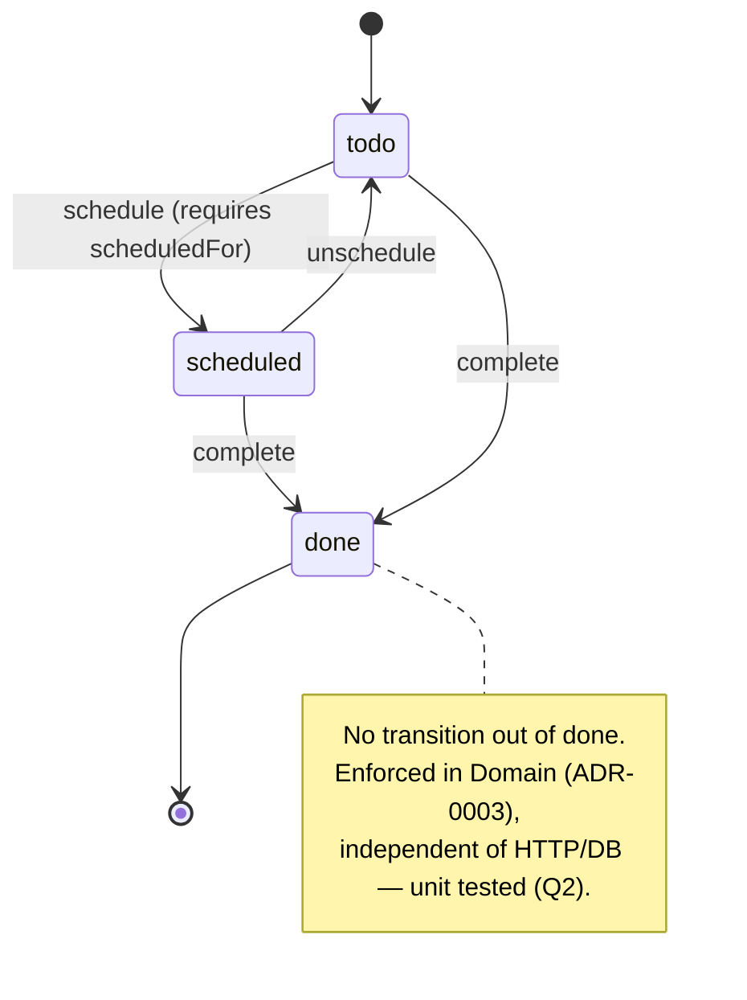
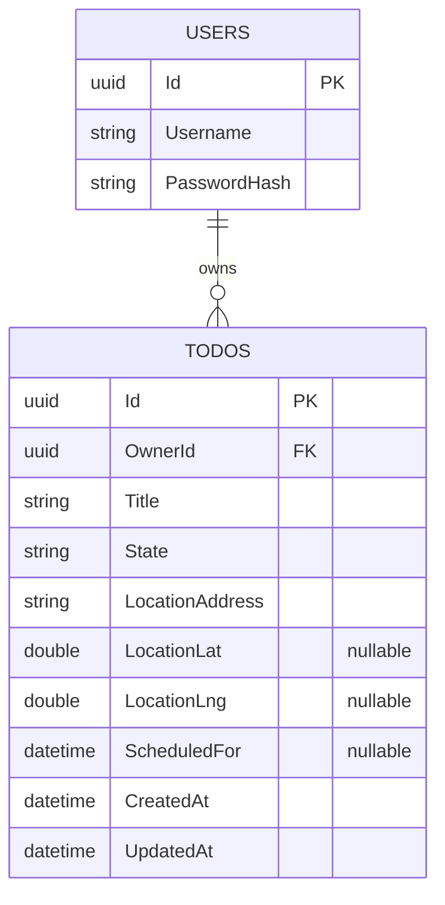

# Design

Design-level artefacts implementing the Step 2 architecture. Every element here traces back
to an ADR or a Step 1 scenario — nothing new is decided in this document.

## Domain state machine (A3, Q2)

**Invariants** (enforced in `Domain`, not the controller — ADR-0003):
- `ScheduledFor` is required when state = `scheduled`, and cleared when unscheduled back to `todo`.
- `done` is terminal: no transition leaves it. An attempt returns 409 via the
  `/todos/{id}/transition` endpoint (see `openapi.yaml`).
- `todo -> done` is allowed directly (a job finished without ever being formally scheduled).

## Data model (ERD)

- `Users` is minimal and self-issued per A6/ADR-0007 — a seeded dev user or a simple
  `/auth/login`, not a full identity system.
- Concurrency token: PostgreSQL's `xmin` system column (ADR-0004) — not modeled as an
  explicit column, EF Core maps it as a shadow concurrency property.
- **Index:** composite `(OwnerId, State)` on `Todos` — every list query filters by both
  (Q1 + Q3), so this is the one index that actually matters at this scale.
- **EF Core authoring:** code-first (entities in `Domain`, migrations generated from them).
  This is a Step 3 design choice, not a Step 2 ADR — greenfield project, no existing schema
  to reverse from, so it doesn't meet the "architecturally significant" bar (see prior
  discussion; doesn't affect Q1-Q7, doesn't constrain other decisions).

## Threat model (STRIDE, one pass)
| Threat | Concrete risk here | Mitigation | Status |
|---|---|---|---|
| **S**poofing | Forged/stolen JWT | Signed token (ADR-0007), httpOnly cookie limits JS-based theft (ADR-0002), short expiry | Built |
| **T**ampering | Client sends someone else's `OwnerId`, or edits a stale/tampered todo | `OwnerId` always taken from the validated token server-side, never from the request body; `If-Match`/ETag required on updates (Q6) | Built |
| **R**epudiation | No record of who changed what | Structured logs with correlation ID (per `production-readiness.md`) | Partial — basic logs only, no audit trail |
| **I**nformation disclosure | User A discovers user B's todo exists via ID enumeration | Cross-owner access returns 404, not 403 (Q1, explicit in `openapi.yaml`) | Built |
| **D**enial of service | Unbounded list requests, brute-force login | Pagination caps `pageSize` (Q3); rate limiting on `/auth/login` | Pagination built; rate limiting **deferred** — add to `production-readiness.md` |
| **E**levation of privilege | Any authenticated user reaching another's data via a guessed/incremented ID | Every query filtered server-side by `OwnerId` from the token (Q1), tested via `OwnerIsolationTests` | Built |

## Frontend design (implements ADR-0012, ADR-0013)
- **Component shape:** `TodoListPage` (data via TanStack Query) → `TodoCard` (state badge,
  location, schedule button) → `TodoForm` (create/edit, client + server validation errors
  mapped from ProblemDetails).
- **Required states per view** (per `AGENTS.md`'s frontend rule): loading, empty ("no todos
  yet"), error (ProblemDetails message surfaced, not a raw stack trace), and the populated
  list.
- **Mutations** (create/update/delete/transition) use TanStack Query mutations with
  invalidation of the list query on success — no Redux needed (ADR-0013).
- **Concurrency UX:** a 409 on update surfaces as "this todo changed elsewhere, reload?" —
  the visible product behaviour behind Q6/ADR-0004, worth being able to demo live.
